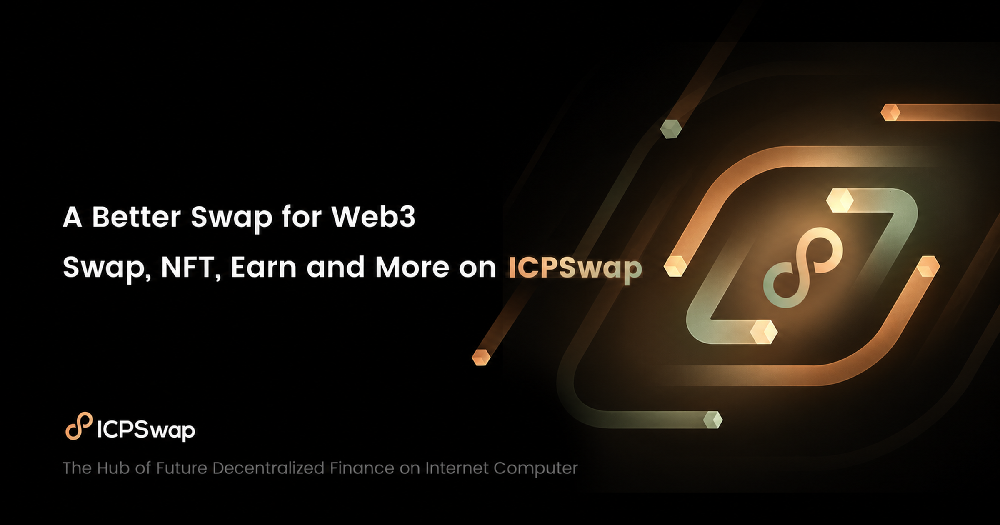

# ICPSwap

## Development Quick Start

Ensure you have

- [Node.js](https://nodejs.org) 22.x installed
- [Pnpm](https://pnpm.io/) v10.15.1 available through Corepack

You need a **personal access token** to install some of our npm packages.

The token must have the `repo` and `read:packages` scopes to login to the [GitHub Package Registry](https://docs.github.com/en/packages/working-with-a-github-packages-registry/working-with-the-npm-registry#authenticating-to-github-packages).

If you don't have one, create the personal access token [in the developer settings](https://github.com/settings/tokens).

Run the following command to authenticate, using the **personal access token** as your **password**:

```
npm login --registry=https://npm.pkg.github.com --scope=@honopu
```

Then run the following:

- `npm i -g typescript` to install typescript.
- `pnpm i` to install dependencies.
- `pnpm run dev` to start the development server
- `pnpm run build` to build

## Local development without private package access

With Node.js 22 and Corepack available, run `pnpm run install:local`, then `pnpm run dev` to preview the app without GitHub Packages credentials.

This explicit local install uses a pnpm `readPackage` hook to substitute the public `@dfinity/auth-client@2.1.2` for `@honopu/auth-client` in installed dependencies. It generates an ignored `.local-dev/pnpm-lock.yaml` from the canonical lockfile and keeps all public dependency versions frozen. Production package manifests and `pnpm-lock.yaml` remain unchanged. Wallet sign-in with the public client is unverified because it may differ from the private fork.

Use this fallback only for local development. Before producing a release, run the normal authenticated install above to restore the private client. CI and production must use the normal install; the local helper refuses to run in those environments.

## Design system

Tailwind CSS 4 and daisyUI 5 are compiled through Vite. The header's **Design version** selector switches between **Original design** (`classic`) and **New design** (`modern`, the default). The selection is saved in local storage under `icswap.design.version` and synchronized across tabs. Missing, invalid, or unavailable storage falls back to the new design. Switching designs shares existing application and transaction state.

The `icswap-classic` / `icswap-classic-light` themes preserve the original blue/violet palette, Poppins typography, compact trading layout, and horizontal navigation. The `icswap` / `icswap-light` themes retain the graphite/copper/sage redesign, Manrope and IBM Plex Mono, and desktop sidebar. Both layouts use Tailwind utilities and daisyUI semantic colors (`base-100`, `primary`, `success`, etc.) alongside the existing MUI controls. Shared components in `packages/ui/src` are included in Tailwind's source scanning.

The MUI theme bridges existing trading controls and wallet dialogs to these colors, retaining their interaction behavior. Its standard palette slots use matching literal colors because MUI color helpers require them. CssBaseline supplies the reset; Tailwind Preflight is intentionally omitted to preserve third-party control sizing. Fonts are served locally with their licenses, and motion respects the system's reduced-motion setting. Classic artwork is preserved in `apps/swap/public/images/design-classic`; the modern artwork filter applies only to the new design. The ICS token logo retains its original colors in both versions.
